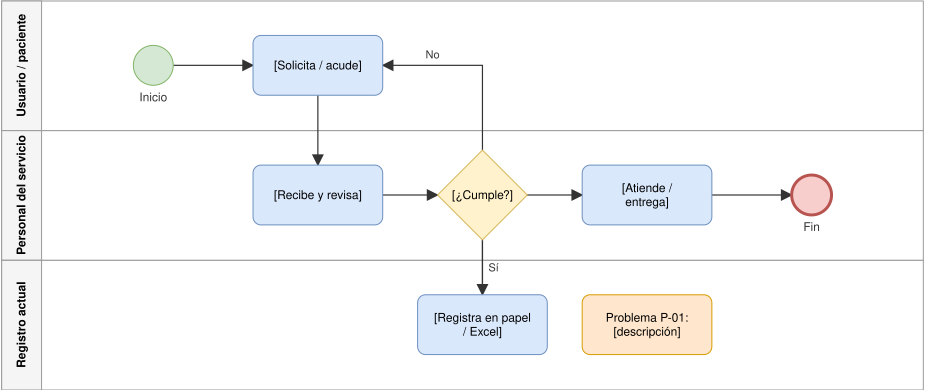

# Proceso actual (AS-IS)

!!! info "Qué va aquí"
    Cómo funciona hoy el proceso, sin el sistema nuevo. Edita el diagrama con draw.io (aplicación de escritorio o extensión de VS Code), guardándolo como `.drawio.svg`: usa un carril por actor, numera los pasos y marca con notas naranjas dónde aparecen los problemas.

## Diagrama del flujo actual

## Descripción de los pasos

| Paso | Actor | Actividad | Herramienta | Tiempo | Volumen |
|---|---|---|---|---|---|
| 1 | [Paciente] | [Solicita ...] | [Ventanilla] | [10 min] | [X por día] |
| 2 | [Personal] | [Revisa ...] | [Papel / Excel / sistema] | [Tiempo] | [Volumen] |

## Problemas encontrados en el flujo

| ID | Problema | Paso | Frecuencia | Impacto | Evidencia |
|---|---|---|---|---|---|
| P-01 | [Ejemplo: datos duplicados en dos formatos] | [2] | [Diaria] | [Alto / Medio / Bajo] | [Observación, registro] |
| P-02 | [Problema] | [Paso] | [Frecuencia] | [Impacto] | [Evidencia] |

## Documentos y formatos que se usan

| Documento | Para qué | Quién lo llena |
|---|---|---|
| [Formato X] | [Uso] | [Actor] |
