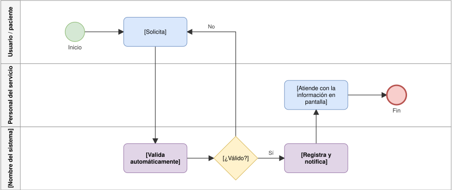

# Proceso propuesto (TO-BE)

!!! info "Qué va aquí"
    Cómo funcionará el proceso con el sistema. Usa los mismos carriles que en el AS-IS para que la comparación sea directa; el carril del sistema muestra lo que se automatiza.

## Diagrama del flujo propuesto

## Cambios respecto al proceso actual

| Paso actual (AS-IS) | Paso nuevo (TO-BE) | Problema que resuelve | Beneficio |
|---|---|---|---|
| [2. Revisión manual] | [El sistema valida al registrar] | [P-01] | [Menos errores, ahorro de X min] |
| [Paso] | [Paso nuevo] | [P-0X] | [Beneficio] |

## Impacto en los roles

| Rol | Qué cambia en su trabajo | Capacitación necesaria |
|---|---|---|
| [Enfermería] | [Registra en tablet en lugar de papel] | [Uso del módulo X, 1 h] |

## Plan de transición

1. [Convivencia: periodo en que se usan ambos procesos.]
2. [Migración de datos históricos, si aplica.]
3. [Fecha de corte del proceso anterior.]
