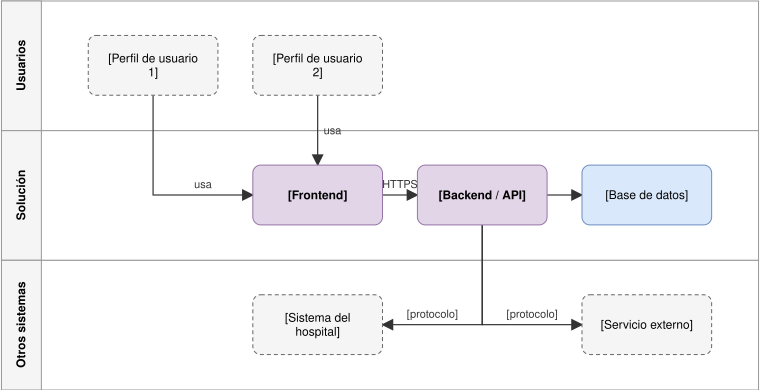

# Solución propuesta

!!! info "Qué va aquí"
    Cómo resuelve el sistema los requisitos. Empieza por el contexto (quién usa el sistema y con qué se conecta) y baja al detalle de módulos, datos, integraciones y seguridad.

## Visión general

[Descripción breve de la solución en un párrafo.]

## Arquitectura

| Componente | Responsabilidad | Tecnología | Se comunica con |
|---|---|---|---|
| [Frontend] | [Interfaz para registrar y consultar] | [Ver Stack tecnológico] | [Backend] |
| [Backend / API] | [Reglas de negocio y acceso a datos] | [Tecnología] | [Base de datos, sistemas externos] |
| [Base de datos] | [Persistencia] | [Motor] | [Backend] |

## Módulos y funcionalidades

| Módulo | Funcionalidades | Requisitos que cubre | Usuarios |
|---|---|---|---|
| [Registro] | [Alta, edición, búsqueda] | [RF-01, RF-02] | [Enfermería] |
| [Reportes] | [Indicadores, exportación] | [RF-05] | [Jefatura] |

## Modelo de datos

[Diagrama de entidades: un bloque `mermaid` con `erDiagram` o un `.drawio.svg` en `docs/img/`.]

| Entidad | Descripción | Datos sensibles |
|---|---|---|
| [Paciente] | [Datos de identificación] | **Sí:** [DNI, nombres, diagnóstico] |
| [Atención] | [Registro de cada atención] | [Sí / No] |

## Integraciones

| Sistema | Dirección | Datos | Protocolo / formato | Frecuencia |
|---|---|---|---|---|
| [Sistema del hospital] | [Entrada / salida] | [Qué datos] | [REST / archivo / BD] | [Tiempo real / diaria] |

## API

[Enlace a la especificación OpenAPI o tabla de los endpoints principales.]

## Seguridad

**Autenticación:** [Cómo se identifican los usuarios.]

**Roles y permisos:**

| Acción | [Rol 1] | [Rol 2] | [Rol 3] |
|---|---|---|---|
| [Registrar] | Sí | Sí | No |
| [Consultar] | Sí | Sí | Sí |
| [Eliminar] | Sí | No | No |

**Protección de datos:** [cifrado en tránsito y en reposo, enmascaramiento, retención].

**Auditoría:** [qué acciones se registran y dónde].

## Decisiones técnicas

[Una página por decisión en `docs/decisiones/`, con la plantilla «Decisión técnica»; enlázalas aquí.]
